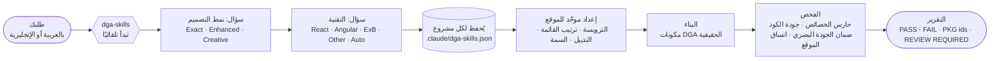

[English](README.md) | **العربية**

<div dir="rtl">

<div align="center">

# DGA Skills Toolkit

**مهارة (Skill) لـ Claude لبناء واجهات الحكومة الرقمية السعودية وفق «كود المنصات» DGA Platforms Code — العربية أولًا، ومكونات DGA الحقيقية، وإعداد موحّد للموقع، وفحوص جودة قابلة للقياس.**

الإصدار **5.0.3** · Claude Code · Claude Desktop / Cowork · React · Angular · ArcGIS Experience Builder · Web Components

[التثبيت](#التثبيت) · [البداية](docs/GETTING-STARTED.ar.md) · [أمثلة الأوامر](docs/PROMPT-EXAMPLES.ar.md) · [الحدود المعروفة](docs/KNOWN-LIMITATIONS.ar.md) · [English](README.md)

</div>

## التثبيت

### Claude Code — macOS / Linux

```bash
git clone https://github.com/Ahmed-Darwish55/DGA-Skills-Toolkit.git
cd DGA-Skills-Toolkit
python3 install.py install
```

### Claude Code — Windows

```powershell
git clone https://github.com/Ahmed-Darwish55/DGA-Skills-Toolkit.git
cd DGA-Skills-Toolkit
.\install.ps1 install
```

أو في موجّه الأوامر (Command Prompt): `install.cmd install`. ثم ابدأ جلسة جديدة في Claude Code.

### Claude Desktop / Cowork

1. نزّل الملف `DGA-Skills-Toolkit-V5.0.3-COWORK-UPLOAD.zip` من [أحدث إصدار](https://github.com/Ahmed-Darwish55/DGA-Skills-Toolkit/releases/tag/v5.0.3).
2. في Claude، افتح **Customize › Skills › Upload skill** واختر ملف ZIP.
3. فعّل **dga-skills** وابدأ مهمة جديدة.

### التحقق من أنها تعمل

```bash
python3 install.py verify
python3 install.py self-check
```

ثم اطلب من Claude واجهة حكومية دون ذكر اسم المهارة، مثلًا: *"Build a DGA service page for Building Permit Issuance, Arabic first"*. يجب أن يقتصر الرد الأول على السؤال عن **نمط التصميم** فقط.

المتطلبات: Python 3.8+ لأداة التثبيت. الدليل الكامل والخيارات والترقية والتراجع: **[docs/INSTALLATION.ar.md](docs/INSTALLATION.ar.md)**.

> [!IMPORTANT]
> **مشروع مستقل.** DGA Skills Toolkit غير تابع لهيئة الحكومة الرقمية السعودية (DGA)، ولا معتمد منها، ولا حاصل على شهادة منها. تشير «DGA» إلى نظام التصميم الذي تتبعه الأداة، وهو DGA Platforms Code. توصف النتائج بأنها *متوافقة مع DGA*، ولا توصف أبدًا بأنها *معتمدة من DGA*.
> أنشأه وطوّره **أحمد درويش**.

## ما هي

DGA Skills Toolkit مهارة لـ Claude (`dga-skills`). عندما تطلب من Claude واجهة حكومية — مكوّنًا أو صفحة أو بوابة كاملة — تجعل المهارة Claude يبنيها من DGA Platforms Code:

- **مكونات DGA الحقيقية** من حزم `@platformscode/*`، بالمتغيرات (variants) والحالات والرموز التصميمية (tokens) الخاصة بـ DGA Platforms Code؛
- **إعداد موحّد للموقع** يمنح كل صفحة الترويسة والتنقل والتذييل والسمة نفسها؛
- **فحوص يمكنك تكرارها**: حارس للخصائص (prop guard)، وفحص لجودة الكود، ومحرك ضمان جودة بصري يختبر اتجاهي RTL وLTR على أربعة عروض، واستخدام لوحة المفاتيح، وإمكانية الوصول، والتكبير، وتقليل الحركة.

### لمن هي

- مطوّرو الواجهات الأمامية والفرق التي تبني البوابات والخدمات الإلكترونية الحكومية السعودية.
- مصممو UI/UX الذين يبنون النماذج الأولية باستخدام Claude ويحتاجون مخرجات تتبع DGA Platforms Code.
- فرق نظم المعلومات الجغرافية (GIS) التي تبني تطبيقات ArcGIS Experience Builder للجهات الحكومية.
- المراجعون الذين يدققون موقعًا قائمًا مقابل DGA Platforms Code.

## المزايا

| | |
|---|---|
| **معرفة DGA مدمجة** | 210 مجموعات مكونات، و10,499 متغيرًا، و20 قالب صفحة، ومواصفات الويب والجوال، والرموز التصميمية. تعمل دون اتصال بالإنترنت. |
| **ثلاثة أنماط تصميم** | **DGA Exact** و**DGA Enhanced** و**DGA Creative**، لكلٍّ منها قواعده وبوابات الجودة الخاصة به. |
| **إعداد يبدأ بنمط التصميم** | سؤال واحد في كل مرة: نمط التصميم، ثم التقنية. يُحفظ لكل مشروع في `.claude/dga-skills.json`. |
| **إعداد موحّد للموقع** | الهوية، والتنقل المرتّب (سهم الفتح يظهر فقط على العناصر التي لها قائمة فرعية)، وإجراءات الترويسة، والتذييل، وسمة مبنية على الرموز التصميمية فقط — متطابقة في كل صفحة، في React وvanilla وAngular وArcGIS Experience Builder. |
| **حزم حقيقية، دون خصائص مخترعة** | واجهات برمجة المكونات لـ `@platformscode/core` بالإصدارات 0.0.17 / 0.0.52 / 0.0.53، مع حارس للخصائص. عيوب الحزم المعروفة يُبلَّغ عنها بمعرّفها، ولا تُخفى أبدًا. |
| **20 قالب صفحة** | منها اليوم الوطني السعودي، ويوم التأسيس السعودي، والحج. |
| **العربية RTL والإنجليزية LTR** | RTL أولًا، وCSS منطقي، وأيقونات تراعي الاتجاه؛ وكل فحص يعمل في الاتجاهين. |
| **محرك ضمان الجودة البصري** | تجاوز التخطيط، واستخدام الرموز التصميمية، ولوحة المفاتيح والتركيز، وaxe، والتكبير 200 %، وتقليل الحركة، والنماذج، وحجم الحزمة، واتساق الترويسة والتذييل في جميع الصفحات. |
| **قواعد الكود النظيف** | يُبلَّغ عن مشكلات التسمية، والكود غير المستخدم، والدوال المساعدة والكتل والنصوص المكررة، والصفحات التي تحدد تصميم ترويستها أو تذييلها بنفسها. |
| **الحركة** | قصص GSAP/ScrollTrigger تراعي تقليل الحركة، وThree.js اختياريًا لنمط Creative — ولا تُستخدم أبدًا داخل مكونات DGA. |
| **أدوات مساعدة اختيارية** | تُثبَّت Frontend Design (من Anthropic) وUI/UX Pro Max (برخصة MIT) تلقائيًا في Claude Code من مصادرها الرسمية؛ وفي Cowork تُستخدم إذا كنت قد فعّلتها. |
| **تثبيت آمن** | فحص السلامة، ونسخة احتياطية قبل كل تغيير، وإمكانية التراجع. |

## أنماط التصميم

| النمط | الأنسب لـ | ما يمكن تغييره | ما لا يُسمح به أبدًا |
|---|---|---|---|
| **DGA Exact** | الخدمات الإلكترونية، والنماذج، والبوابات | لا شيء خارج المواصفات الرسمية | متغيرات جديدة، أو حركة تزيينية، أو GSAP أو 3D |
| **DGA Enhanced** | صفحات الهبوط، والحملات، ولوحات المعلومات | التكوين والتسلسل البصري، مع وسم كل إضافة | إعادة تنسيق مكونات DGA |
| **DGA Creative** | السرد القصصي، والفعاليات، وصفحات العرض | التوجيه الفني، وGSAP/ScrollTrigger، وThree.js اختياريًا | الإخلال بإطار DGA (الترويسة والتذييل)، أو إمكانية الوصول، أو تقليل الحركة |

التفاصيل: [docs/DESIGN-MODES.ar.md](docs/DESIGN-MODES.ar.md).

## التوافق

| البيئة | الدعم |
|---|---|
| Claude Code — macOS / Linux | مدعوم |
| Claude Code — Windows | مدعوم؛ لم يُتحقق منه بعد على جهاز Windows فعلي |
| Claude Desktop / Cowork | مدعوم عبر ملف ZIP للرفع؛ لم يُتحقق بعد من رفع 5.0.3 على حساب فعلي |
| React 18 + `platformscode-new-react` | مدعوم |
| Angular 19 (standalone, strict) | مدعوم |
| Vanilla JS / Web Components | مدعوم |
| ArcGIS Experience Builder 1.14–1.18 | مدعوم؛ لم يُتحقق منه بعد في بيئة تشغيل Experience Builder فعلية |
| Vue, Svelte, Lit, Next.js | عبر مسار Web Components |

المزيد: [docs/SUPPORTED-FRAMEWORKS.ar.md](docs/SUPPORTED-FRAMEWORKS.ar.md).

## آلية العمل



## الاستخدام

اربط إعدادًا موحّدًا للموقع، ثم ابنِ صفحات تمرّر المحتوى فقط:

```jsx
import { createSiteConfig } from './dga-skills/site/site-config.js';
import { SiteProvider, NavProvider } from './dga-skills/patterns/react/index.js';
import { Home, Service } from './dga-skills/templates/react/index.js';

const siteConfig = createSiteConfig({
  dir: 'rtl',
  identity: { name: 'الجهة الحكومية النموذجية' },
  navigationItems: [
    { id: 'home', route: 'home', label: 'الرئيسية' },
    { id: 'services', route: 'services', label: 'الخدمات', children: [{ label: 'خدمات الأفراد', href: '#' }] },
    { id: 'news', route: 'news', label: 'الأخبار' },
  ],
  theme: { footerVariant: 'DarkGreen' },
});

<SiteProvider siteConfig={siteConfig}>
  <NavProvider active={route} go={navigateTo}>{route === 'home' ? <Home dir="rtl" /> : <Service dir="rtl" />}</NavProvider>
</SiteProvider>
```

انسخ المكتبة إلى مشروعك وافحص النتيجة:

```bash
S=~/.claude/skills/dga-skills
python3 $S/tools/copy_lib.py --framework react --dest src/dga-skills --with-patterns
python3 $S/tools/check_dga_props.py --project .
python3 $S/tools/code_quality_check.py --path src --pages src/pages
node $S/tools/qa/run.mjs --config qa.config.json
```

أمثلة vanilla وAngular وArcGIS Experience Builder: [docs/GETTING-STARTED.ar.md](docs/GETTING-STARTED.ar.md). القوالب: [docs/TEMPLATES.ar.md](docs/TEMPLATES.ar.md). اثنا عشر أمرًا جاهزًا للاستخدام: [docs/PROMPT-EXAMPLES.ar.md](docs/PROMPT-EXAMPLES.ar.md).

## لقطات الشاشة

صفحات معروضة من قوالب الأداة بمحتوى تجريبي (React، DGA Exact، العربية):

| الرئيسية | دليل الخدمات | تفاصيل الخدمة |
|---|---|---|
|  |  |  |

| الأسئلة الشائعة | الرئيسية (الجوال) | الخدمة (الجوال) |
|---|---|---|
|  |  |  |

## الحدود المعروفة

- لم يُتحقق بعد على بيئات فعلية من ArcGIS Experience Builder، ولا من أداة التثبيت على Windows، ولا من رفع الإصدار 5.0.3 إلى Cowork.
- لا يمكن ادعاء **التوافق الكامل مع DGA Exact** للصفحات التي تستخدم مكونات فيها عيوب مفتوحة في حزم `@platformscode/*` (مثل دعم لوحة المفاتيح في القائمة المنسدلة، والتبويبات، والتركيز في النافذة المنبثقة). تُبلّغ الأداة عن هذه العيوب بمعرّفاتها.
- 11 من أصل 20 قالبًا تُولَّد كهياكل أولية: نقطة انطلاق، وليست صفحات مكتملة.

القائمة الكاملة: [docs/KNOWN-LIMITATIONS.ar.md](docs/KNOWN-LIMITATIONS.ar.md).

## التوثيق

| الدليل | |
|---|---|
| [التثبيت](docs/INSTALLATION.ar.md) | Claude Code (macOS / Linux / Windows) وClaude Desktop / Cowork |
| [البداية](docs/GETTING-STARTED.ar.md) | الطلب الأول، وإعداد الموقع، والكود لكل تقنية |
| [أمثلة الأوامر](docs/PROMPT-EXAMPLES.ar.md) | 12 أمرًا جاهزًا للنسخ وفحوص للسلوك |
| [أنماط التصميم](docs/DESIGN-MODES.ar.md) · [الأطر المدعومة](docs/SUPPORTED-FRAMEWORKS.ar.md) · [القوالب](docs/TEMPLATES.ar.md) | مرجع |
| [حل المشكلات](docs/TROUBLESHOOTING.ar.md) · [الحدود المعروفة](docs/KNOWN-LIMITATIONS.ar.md) | عندما لا يعمل شيء ما |
| [المساهمة](CONTRIBUTING.ar.md) · [الأمان](SECURITY.ar.md) · [الإشعارات](NOTICE.md) | المشروع |

## الشكر والإسناد

- أنشأه وطوّره **أحمد درويش**.
- بيانات التصميم: **DGA Platforms Code** © هيئة الحكومة الرقمية ([figma.com/@sdga](https://www.figma.com/@sdga))، مستخدمة بموجب [CC BY 4.0](https://creativecommons.org/licenses/by/4.0/).
- المكونات: حزم npm `@platformscode/*`، ويثبّتها مشروعك.
- أدوات مساعدة اختيارية: Frontend Design من Anthropic (Apache-2.0) وUI/UX Pro Max من nextlevelbuilder (MIT)، تُثبَّت من مصادرها الخاصة.

شروط الأطراف الثالثة: [NOTICE.md](NOTICE.md).

## الترخيص

[رخصة MIT](LICENSE) © 2026 Ahmed Darwish. تحتفظ مواد الأطراف الثالثة بشروطها الخاصة (انظر [NOTICE.md](NOTICE.md)).

</div>
