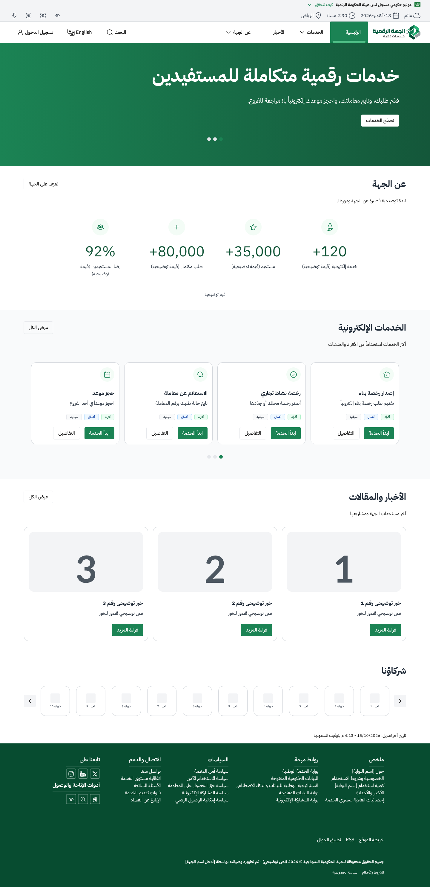
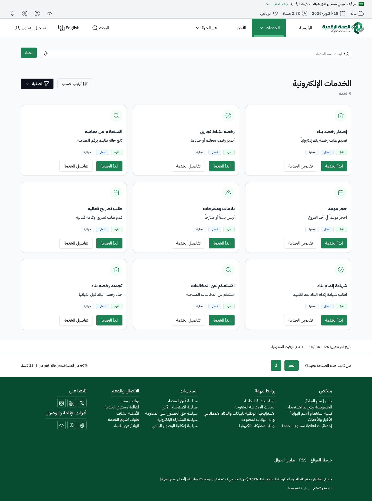
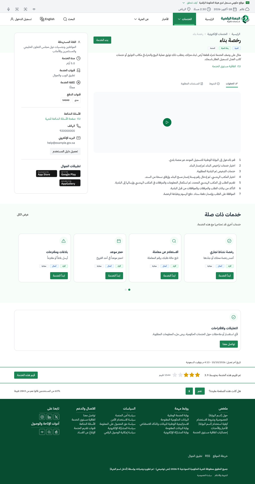
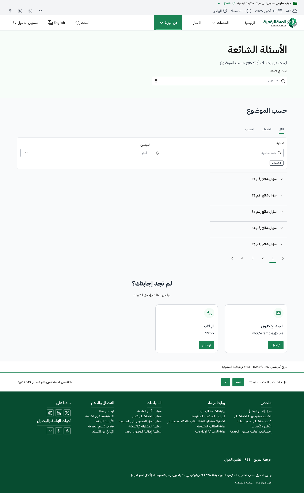
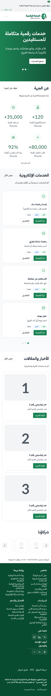
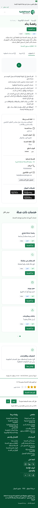

**English** | [العربية](README.ar.md)

<div align="center">

# DGA Skills Toolkit

**A Claude skill for building Saudi digital-government interfaces with the DGA Platforms Code — Arabic first, real DGA components, one site configuration and measurable quality checks.**

Version **5.0.3** · Claude Code · Claude Desktop / Cowork · React · Angular · ArcGIS Experience Builder · Web Components

[Installation](#installation) · [Getting started](docs/GETTING-STARTED.md) · [Prompt examples](docs/PROMPT-EXAMPLES.md) · [Known limitations](docs/KNOWN-LIMITATIONS.md)

</div>

## Installation

### Claude Code — macOS / Linux

```bash
git clone https://github.com/Ahmed-Darwish55/DGA-Skills-Toolkit.git
cd DGA-Skills-Toolkit
python3 install.py install
```

### Claude Code — Windows

```powershell
git clone https://github.com/Ahmed-Darwish55/DGA-Skills-Toolkit.git
cd DGA-Skills-Toolkit
.\install.ps1 install
```

Or in Command Prompt: `install.cmd install`. Then start a new Claude Code session.

### Claude Desktop / Cowork

1. Download `DGA-Skills-Toolkit-V5.0.3-COWORK-UPLOAD.zip` from the [latest release](https://github.com/Ahmed-Darwish55/DGA-Skills-Toolkit/releases/tag/v5.0.3).
2. In Claude, open **Customize › Skills › Upload skill** and choose the ZIP.
3. Turn **dga-skills** on and start a new task.

### Check it works

```bash
python3 install.py verify
python3 install.py self-check
```

Then ask Claude for a government UI without naming the skill, for example *"Build a DGA service page for Building Permit Issuance, Arabic first"*. The first reply should ask only for the **design mode**.

Requirements: Python 3.8+ for the installer. Full guide, options, upgrade and rollback: **[docs/INSTALLATION.md](docs/INSTALLATION.md)**.

> [!IMPORTANT]
> **Independent project.** DGA Skills Toolkit is not affiliated with, endorsed by, or certified by the Saudi Digital Government Authority (DGA). "DGA" names the design system it follows, the DGA Platforms Code. Results are described as *DGA-aligned*, never as *DGA-certified*.
> Created and developed by **Ahmed Darwish**.

## What it is

DGA Skills Toolkit is a skill for Claude (`dga-skills`). When you ask Claude for a government interface — a component, a page or a whole portal — the skill makes Claude build it from the DGA Platforms Code:

- the **real DGA components** from the `@platformscode/*` packages, with the variants, states and tokens of the DGA Platforms Code;
- **one site configuration** that gives every page the same header, navigation, footer and theme;
- **checks you can repeat**: a prop guard, a code-quality check and a visual QA engine that tests RTL and LTR at four widths, keyboard use, accessibility, zoom and reduced motion.

### Who it is for

- Front-end developers and teams building Saudi government portals and e-services.
- UI/UX designers who prototype with Claude and need output that follows the DGA Platforms Code.
- GIS teams building ArcGIS Experience Builder apps for government entities.
- Reviewers who audit an existing site against the DGA Platforms Code.

## Features

| | |
|---|---|
| **DGA knowledge built in** | 210 component sets, 10,499 variants, 20 page templates, Web and Mobile specs and design tokens. Works offline. |
| **Three design modes** | **DGA Exact**, **DGA Enhanced** and **DGA Creative**, each with its own rules and quality gates. |
| **Design-mode-first onboarding** | One question at a time: design mode, then technology. Saved per project in `.claude/dga-skills.json`. |
| **One site configuration** | Identity, ordered navigation (a chevron only on items with a sub-menu), header actions, footer and a token-only theme — the same on every page, in React, vanilla, Angular and ArcGIS Experience Builder. |
| **Real packages, no invented props** | Component APIs for `@platformscode/core` 0.0.17 / 0.0.52 / 0.0.53 and a prop guard. Known package defects are reported by ID, never hidden. |
| **20 page templates** | Including Saudi National Day, Saudi Founding Day and Hajj. |
| **Arabic RTL and English LTR** | RTL first, logical CSS, direction-aware icons; every check runs in both directions. |
| **Visual QA engine** | Layout overflow, token use, keyboard and focus, axe, 200 % zoom, reduced motion, forms, bundle size, and header/footer consistency across all pages. |
| **Clean code rules** | Naming, dead code, duplicated helpers, blocks and texts, and pages that set their own header or footer design are reported. |
| **Motion** | Reduced-motion-aware GSAP/ScrollTrigger stories and optional Three.js for Creative mode — never inside DGA components. |
| **Optional helpers** | Frontend Design (Anthropic) and UI/UX Pro Max (MIT) are installed automatically in Claude Code from their official sources; in Cowork they are used when you have turned them on. |
| **Safe install** | Integrity check, backup before every change and rollback. |

## Design modes

| Mode | Best for | May change | Never |
|---|---|---|---|
| **DGA Exact** | e-services, forms, portals | nothing beyond the official specs | new variants, decorative motion, GSAP or 3D |
| **DGA Enhanced** | landing pages, campaigns, dashboards | composition and hierarchy, with every addition labelled | restyling DGA components |
| **DGA Creative** | storytelling, events, showcases | art direction, GSAP/ScrollTrigger, optional Three.js | breaking DGA chrome, accessibility or reduced motion |

Details: [docs/DESIGN-MODES.md](docs/DESIGN-MODES.md).

## Compatibility

| Environment | Support |
|---|---|
| Claude Code — macOS / Linux | supported |
| Claude Code — Windows | supported; not yet confirmed on a real Windows host |
| Claude Desktop / Cowork | supported through the upload ZIP; 5.0.3 upload not yet confirmed on a live account |
| React 18 + `platformscode-new-react` | supported |
| Angular 19 (standalone, strict) | supported |
| Vanilla JS / Web Components | supported |
| ArcGIS Experience Builder 1.14–1.18 | supported; not yet confirmed in a real Experience Builder runtime |
| Vue, Svelte, Lit, Next.js | through the Web Components path |

More: [docs/SUPPORTED-FRAMEWORKS.md](docs/SUPPORTED-FRAMEWORKS.md).

## How it works

```mermaid
flowchart LR
    U(["Your request<br/>Arabic or English"]) --> S{{"dga-skills<br/>starts automatically"}}
    S --> M["Ask: design mode<br/>Exact · Enhanced · Creative"]
    M --> T["Ask: technology<br/>React · Angular · ExB · Other · Auto"]
    T --> P[("Saved per project<br/>.claude/dga-skills.json")]
    P --> C["One site configuration<br/>header · menu order · footer · theme"]
    C --> B["Build<br/>real DGA components"]
    B --> Q["Check<br/>prop guard · code quality<br/>visual QA · site consistency"]
    Q --> R(["Report<br/>PASS · FAIL · PKG ids · REVIEW REQUIRED"])
```



## Usage

Wire one site configuration, then build pages that pass content only:

```jsx
import { createSiteConfig } from './dga-skills/site/site-config.js';
import { SiteProvider, NavProvider } from './dga-skills/patterns/react/index.js';
import { Home, Service } from './dga-skills/templates/react/index.js';

const siteConfig = createSiteConfig({
  dir: 'rtl',
  identity: { name: 'الجهة الحكومية النموذجية' },
  navigationItems: [
    { id: 'home', route: 'home', label: 'الرئيسية' },
    { id: 'services', route: 'services', label: 'الخدمات', children: [{ label: 'خدمات الأفراد', href: '#' }] },
    { id: 'news', route: 'news', label: 'الأخبار' },
  ],
  theme: { footerVariant: 'DarkGreen' },
});

<SiteProvider siteConfig={siteConfig}>
  <NavProvider active={route} go={navigateTo}>{route === 'home' ? <Home dir="rtl" /> : <Service dir="rtl" />}</NavProvider>
</SiteProvider>
```

Copy the library into a project and check the result:

```bash
S=~/.claude/skills/dga-skills
python3 $S/tools/copy_lib.py --framework react --dest src/dga-skills --with-patterns
python3 $S/tools/check_dga_props.py --project .
python3 $S/tools/code_quality_check.py --path src --pages src/pages
node $S/tools/qa/run.mjs --config qa.config.json
```

Vanilla, Angular and ArcGIS Experience Builder examples: [docs/GETTING-STARTED.md](docs/GETTING-STARTED.md). Templates: [docs/TEMPLATES.md](docs/TEMPLATES.md). Twelve ready-to-use prompts: [docs/PROMPT-EXAMPLES.md](docs/PROMPT-EXAMPLES.md).

## Screenshots

Pages rendered from the toolkit's templates with placeholder content (React, DGA Exact, Arabic):

| Home | Services catalogue | Service details |
|---|---|---|
|  |  |  |

| FAQ | Home (mobile) | Service (mobile) |
|---|---|---|
|  |  |  |

## Known limitations

- ArcGIS Experience Builder, the Windows installer and the Cowork upload of 5.0.3 are not yet confirmed on real hosts.
- **Full DGA Exact compliance** cannot be claimed for pages that use components with open defects in the `@platformscode/*` packages (for example dropdown keyboard support, tabs, modal focus). The toolkit reports these by ID.
- 11 of the 20 templates are generated as skeletons: a starting point, not finished pages.

Full list: [docs/KNOWN-LIMITATIONS.md](docs/KNOWN-LIMITATIONS.md).

## Documentation

| Guide | |
|---|---|
| [Installation](docs/INSTALLATION.md) | Claude Code (macOS / Linux / Windows) and Claude Desktop / Cowork |
| [Getting started](docs/GETTING-STARTED.md) | first request, site configuration, code for every technology |
| [Prompt examples](docs/PROMPT-EXAMPLES.md) | 12 copy-ready prompts and behaviour checks |
| [Design modes](docs/DESIGN-MODES.md) · [Supported frameworks](docs/SUPPORTED-FRAMEWORKS.md) · [Templates](docs/TEMPLATES.md) | reference |
| [Troubleshooting](docs/TROUBLESHOOTING.md) · [Known limitations](docs/KNOWN-LIMITATIONS.md) | when something does not work |
| [Contributing](CONTRIBUTING.md) · [Security](SECURITY.md) · [Notices](NOTICE.md) | project |

## Credits

- Created and developed by **Ahmed Darwish**.
- Design data: **DGA Platforms Code** © Digital Government Authority ([figma.com/@sdga](https://www.figma.com/@sdga)), used under [CC BY 4.0](https://creativecommons.org/licenses/by/4.0/).
- Components: the `@platformscode/*` npm packages, installed by your project.
- Optional helpers: Frontend Design by Anthropic (Apache-2.0) and UI/UX Pro Max by nextlevelbuilder (MIT), installed from their own sources.

Third-party terms: [NOTICE.md](NOTICE.md).

## License

[MIT License](LICENSE) © 2026 Ahmed Darwish. Third-party material keeps its own terms (see [NOTICE.md](NOTICE.md)).
