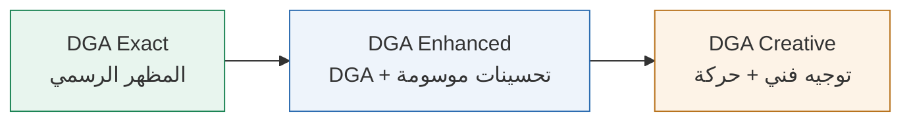

[English](DESIGN-MODES.md) | **العربية**

# أنماط التصميم

تعمل كل مهمة واجهة بنمط واحد فقط. يختار المستخدم النمط، ويُحفظ لكل مشروع في `.claude/dga-skills.json`، ويُطبَّق وفق [`dga-skills/rules/design-modes.md`](../dga-skills/rules/design-modes.md)، وهو النص المعياري.

## قواعد مشتركة بين الأنماط الثلاثة

- عناصر واجهة DGA الأساسية (الأزرار، وحقول الإدخال، والقوائم المنسدلة، والتبويبات، ومربعات الاختيار، والتنبيهات، والنوافذ المنبثقة، والترويسة، والتذييل) تتبع دائمًا `references/dga-live/`: بالمتغيرات والحالات والقيم والبنية والرموز (tokens) نفسها.
- تُقدَّم حزم DGA الحقيقية على إعادة إنشائها بـ CSS، وتُذكر عيوب الحزم المعروفة مع مصادرها ولا تُخفى أبدًا.
- خط IBM Plex Sans Arabic، والعربية من اليمين إلى اليسار (RTL) أولًا، ثم LTR. خصائص CSS المنطقية، وإمكانية الوصول عبر لوحة المفاتيح، وبديل عند تقليل الحركة.
- تحمل كل قيمة وسم مصدر: `[LIVE]`، `[PROJECT]`، `[AHMED HOUSE]`، `[UPSTREAM DESIGN ADVICE]`، `[UNKNOWN]` …
- لا تُكتب عبارات "DGA compliant" أو "100 %" أو "official" أبدًا دون الأدلة التي يتطلبها النمط.

## المقارنة

| | DGA Exact | DGA Enhanced | DGA Creative |
|---|---|---|---|
| الاستخدام المعتاد | الخدمات، والنماذج، والبوابات | صفحات الهبوط والحملات، ولوحات المعلومات التنفيذية | السرد القصصي، والعروض، والفعاليات |
| مكوّنات DGA | المتغيرات الرسمية التي تدعمها الحزمة فقط | دون تغيير | دون تغيير |
| التخطيط | بنية القالب، وشبكة DGA | تحسينات في التكوين والتسلسل البصري | توجيه فني حر حول عناصر DGA الأساسية |
| إضافات House | لا شيء | مسموحة، موسومة بـ `[AHMED HOUSE]` | مسموحة، موسومة |
| الحركة | حركة المواصفات فقط (`INSTANT` = بلا حركة) | ظهور متدرّج متقن بـ CSS / GSAP | GSAP + ScrollTrigger، وThree.js اختياريًا (بالاشتراك، مع بديل) |
| الأدوات المساعدة الخارجية | أسئلة تجربة المستخدم/البنية المعلوماتية (UX/IA) فقط | بحث + نقد | بحث، ومفاهيم، ونقد |
| بوابات QA | E1–E6 | E + N1–N5 | E + N + C1–C5 |

## بوابات QA

| البوابة | المعنى | مؤتمتة؟ |
|---|---|---|
| E1 | جدول الحالات مع الاستشهادات | REVIEW REQUIRED |
| E2 | لقطات شاشة لكل حالة، RTL + LTR | نعم |
| E3 | فحص الرموز (tokens) (لا ألوان خارج اللوحة) | نعم |
| E4 | إمكانية الوصول عبر لوحة المفاتيح وظهور التركيز | نعم |
| E5 | الحركة: أزرار DGA فورية، واحترام تقليل الحركة | نعم |
| E6 | بيان امتثال لكل مكوّن | جزئيًا |
| N1 | لوحة قصة الحركة (storyboard) | REVIEW REQUIRED |
| N2–N5 | 4 عروض × اتجاهين دون تجاوز · حالة ثابتة عند تقليل الحركة · جرد قيم House · CLS ≤ 0.1 | نعم |
| C1–C5 | ثلاث معاينات للمفاهيم + ورقة اعتماد · تقييم بصري · ملاحظات الحركة/3D + بديل WebGL · تراخيص الأصول (`data-licence`) · بيان "creative, not DGA Exact" | C4 مؤتمتة، والبقية REVIEW REQUIRED |
| Z1 · K1 · F1 · B1 | تكبير 200 % · لوحة المفاتيح في العناصر التفاعلية · التحقق من النماذج · ميزانية الحزمة | نعم |

لا تُمنح البوابة الذاتية (التقديرية) PASS تلقائيًا أبدًا. والصفحة التي تستخدم مكوّنًا له عيب مسجّل لدى المورّد يُبلَّغ عنها بأنها **غير ممتثلة** مع ذكر معرّف العيب.

