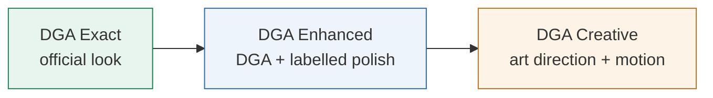

**English** | [العربية](DESIGN-MODES.ar.md)

# Design modes

Each UI task runs in exactly one mode. The mode is chosen by the user, saved per project in `.claude/dga-skills.json` and enforced by [`dga-skills/rules/design-modes.md`](../dga-skills/rules/design-modes.md), which is the normative text.

## Rules for all three modes

- DGA UI chrome (buttons, inputs, dropdowns, tabs, checkboxes, alerts, modals, header, footer) always follows `references/dga-live/`: same variants, states, values, anatomy and tokens.
- Real DGA packages come before CSS recreations, and known package defects are cited, never hidden.
- IBM Plex Sans Arabic, Arabic RTL first, then LTR. Logical CSS properties, keyboard access and a reduced-motion fallback.
- Every value carries a source tag: `[LIVE]`, `[PROJECT]`, `[AHMED HOUSE]`, `[UPSTREAM DESIGN ADVICE]`, `[UNKNOWN]` …
- "DGA compliant", "100 %" or "official" are never written without the evidence that mode requires.

## Comparison

| | DGA Exact | DGA Enhanced | DGA Creative |
|---|---|---|---|
| Typical use | services, forms, portals | landing / campaign pages, executive dashboards | storytelling, showcases, events |
| DGA components | only official variants the package supports | unchanged | unchanged |
| Layout | template structure, DGA grid | composition and hierarchy improvements | free art direction around DGA chrome |
| House additions | none | allowed, labelled `[AHMED HOUSE]` | allowed, labelled |
| Motion | only spec motion (`INSTANT` = none) | tasteful CSS / GSAP reveals | GSAP + ScrollTrigger, optional Three.js (opt-in, with fallback) |
| Upstream helpers | UX/IA questions only | research + critique | research, concepts, critique |
| QA gates | E1–E6 | E + N1–N5 | E + N + C1–C5 |

## QA gates

| Gate | Meaning | Automated? |
|---|---|---|
| E1 | state table with citations | REVIEW REQUIRED |
| E2 | screenshots of every state, RTL + LTR | yes |
| E3 | token lint (no off-palette colour) | yes |
| E4 | keyboard reachability and visible focus | yes |
| E5 | motion: DGA buttons instant, reduced motion honoured | yes |
| E6 | per-component compliance statement | partly |
| N1 | motion storyboard | REVIEW REQUIRED |
| N2–N5 | 4 widths × 2 dirs without overflow · reduced-motion static state · house-value inventory · CLS ≤ 0.1 | yes |
| C1–C5 | three concept previews + approval sheet · visual score · motion/3D notes + WebGL fallback · asset licences (`data-licence`) · "creative, not DGA Exact" statement | C4 automated, the rest REVIEW REQUIRED |
| Z1 · K1 · F1 · B1 | zoom 200 % · widget keyboard · form validation · bundle budget | yes |

A subjective gate is never auto-PASS. A page that uses a component with a registered vendor defect is reported as **not compliant** with the defect ID.
